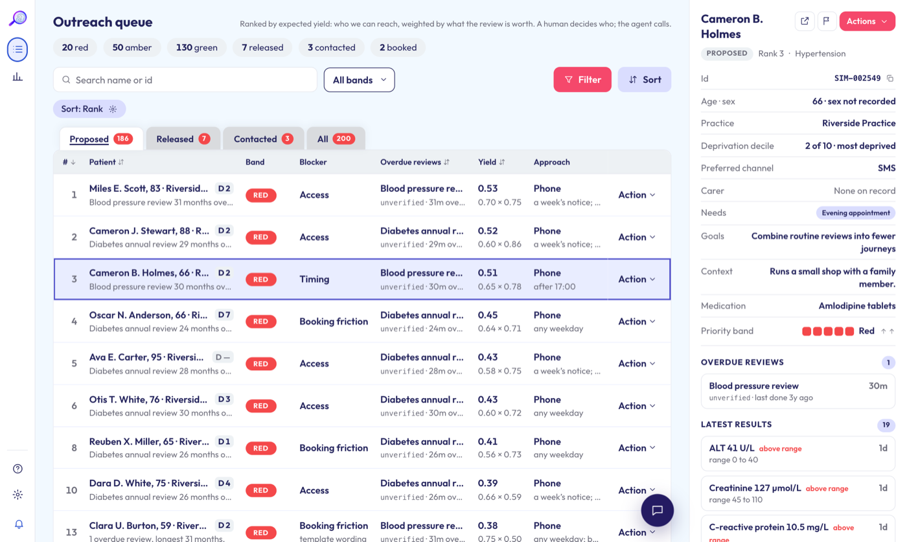
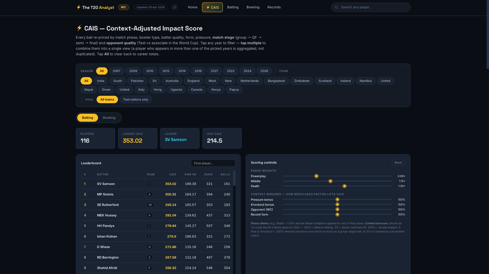
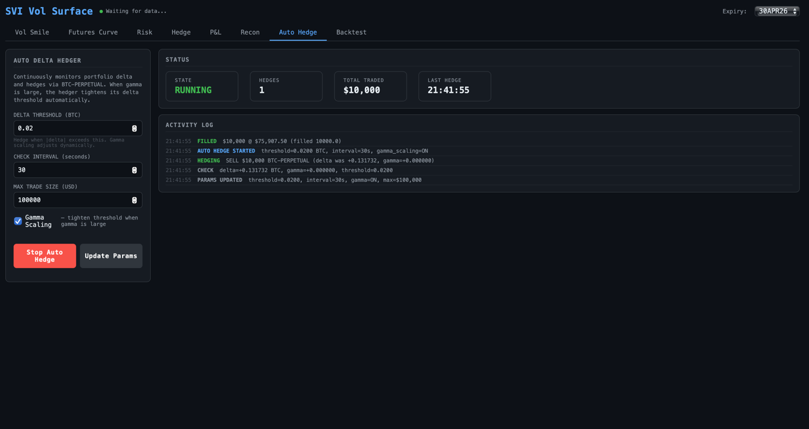
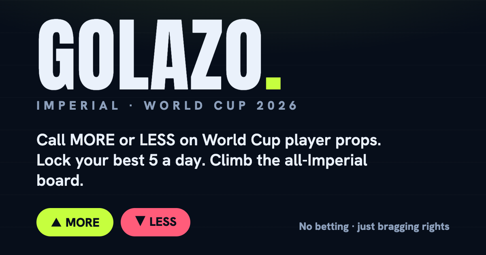

# Mustafa Suleman

I'm studying MEng Design Engineering at Imperial College London. I mostly build things with data and AI, and you can try most of the projects below yourself.

- Won the **OpenAI × Anima hackathon** (1st of 60 participants, picked from 1,000+ applicants) and the Pocket prize for the best voice-based project
- First-class in Year 1 and on the Dean's List. I'm also in Imperial's 1st XI
- Visiting undergraduate at Stanford in summer 2026
- Internships in data science at Turnleaf Analytics (machine learning for macro forecasting) and product engineering at Tewke (smart-home hardware)

You can reach me on [LinkedIn](https://www.linkedin.com/in/mustafaosuleman/) or at [mustafa.o.suleman@gmail.com](mailto:mustafa.o.suleman@gmail.com).

---

## Projects

### [Andrew](https://github.com/Mustafa-OS/anima) · 1st place, OpenAI × Anima hackathon

Four of us built Andrew in a day. It goes through a GP practice's records, ranks patients by clinical need and puts together a case for a clinician to sign off. Then it phones the patient and books the check-up they're overdue for, working around shift patterns, carers or a language barrier, and passing anything clinical to a GP.

I built the calling service. The AI can only act through tool calls that the code checks, so it can't book anything until it has confirmed who it's speaking to, and what goes into the patient's record comes from what the code did rather than the model's own summary.

[Live demo](https://mustafa-os.github.io/anima/) · [Code](https://github.com/Mustafa-OS/anima) · TypeScript, React, Twilio, OpenAI

### [The T20 Analyst](https://github.com/Mustafa-OS/T20-CricketAnalytics)

Ball-by-ball stats for 13 T20 leagues, about 1.8 million deliveries in total. It started as a PSL dashboard and kept growing. Averages and strike rates ignore context, so I came up with CAIS, a score that weights each ball by the match situation: a six in the last over against a top bowler counts for more than a single in a dead game. The data updates every night, and the pipeline won't publish if its numbers drift from the official records.

[Live site](https://mustafa-os.github.io/T20-CricketAnalytics/) · [Code](https://github.com/Mustafa-OS/T20-CricketAnalytics) · Python, pandas, Flask, GitHub Actions

### [Bitcoin options platform](https://github.com/Mustafa-OS/BTC-Trading-Project)

I built this to learn how options market makers manage risk. It connects to Deribit, fits a volatility smile (SVI) to live Bitcoin option prices, and shows the portfolio's Greeks and how they'd change if Bitcoin moved 10% either way. A bot delta-hedges on its own, tightening its trigger when gamma is high, and a backtester lets you try hedging rules on historical prices.

[Browser demo](https://mustafa-os.github.io/BTC-Trading-Project/) · [Code](https://github.com/Mustafa-OS/BTC-Trading-Project) · Python, NumPy, SciPy, WebSockets

### [Agora](https://github.com/Mustafa-OS/agora-mvp)

A team venture project from Stanford's ENGR145 course in technology entrepreneurship. Fans can bet on athletes but they can't invest in them, so Agora lets them buy shares in an athlete's brand. I'm a co-founder and led the algorithm design, which meant building the valuation engine that prices each athlete from their stats, age and fitness. All the trading is simulated.

[Live demo](https://mustafa-os.github.io/agora-mvp/) · [Code](https://github.com/Mustafa-OS/agora-mvp) · JavaScript, Python

### [Golazo](https://github.com/Mustafa-OS/golazo-wc26)

A prediction game I made so Imperial students could play along with the 2026 World Cup. You pick More or Less on player stat lines like shots, saves and goals, and compete on a leaderboard with the rest of Imperial. Riskier picks score more. The server fetches the football data on a schedule and caches it, so 1,000 players cost the same in API calls as 10. Nobody bets money; it's for bragging rights.

[Play it](https://golazo-wc.web.app) · [Code](https://github.com/Mustafa-OS/golazo-wc26) · React, Firebase, Cloud Functions

## Other projects

| Project | What it is | Built with |
|---|---|---|
| [**NBA Player Valuation**](https://github.com/Mustafa-OS/nba-player-valuation) | Rates every NBA player on production, age and fitness, with every assumption as a slider. The pricing model behind Agora. | Python, Streamlit |
| [**ClearVote**](https://github.com/Mustafa-OS/ClearVote) · [demo](https://mustafa-os.github.io/ClearVote/) | Compare UK election candidates on their promises alone, with names and parties hidden until you reveal them. Built at the Claude AI hackathon. | React, TypeScript |
| [**MAG-7 ETF Arbitrage**](https://github.com/Mustafa-OS/MAG-7-ETF-Arbitrage-Strategy) | Backtest of a strategy that trades an ETF against the stocks inside it. Rebuilt from scratch after Goldman Sachs' quant strategies programme. | Python, pandas |
| [**Heart Disease Prediction**](https://github.com/Mustafa-OS/heart-disease-prediction) | Predicts heart disease from routine clinical tests with 85% test accuracy, and shows which tests matter most. Year 1 coursework. | Python, scikit-learn |

## Hardware

### MEGABITE

A hands-free cooking assistant you control with hand gestures, built as an Imperial group project for Human Centred Design. MediaPipe tracks your hands, an ESP32 runs the hardware, there's a React app to control it, and the casing was designed in Fusion 360.

### Handheld games console

Built from scratch around a Raspberry Pi Pico. It went from a breadboard prototype to a Fusion 360 enclosure, then to a soldered, 3D-printed console that runs MicroPython games.

  
  
  

## Tools I use

**Languages:** Python · TypeScript / JavaScript · MATLAB · MicroPython 
**Data & ML:** pandas · NumPy · SciPy · scikit-learn · PyTorch 
**Web & apps:** React · Vite · Flask · Streamlit · Firebase · Node 
**AI & voice:** OpenAI APIs · Twilio · tool-calling agents 
**Hardware:** ESP32 · Raspberry Pi Pico · Fusion 360 · soldering & 3D printing
