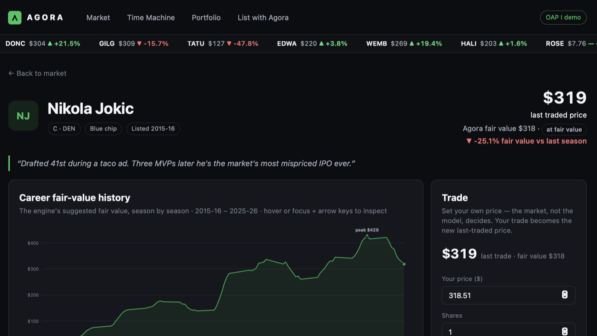
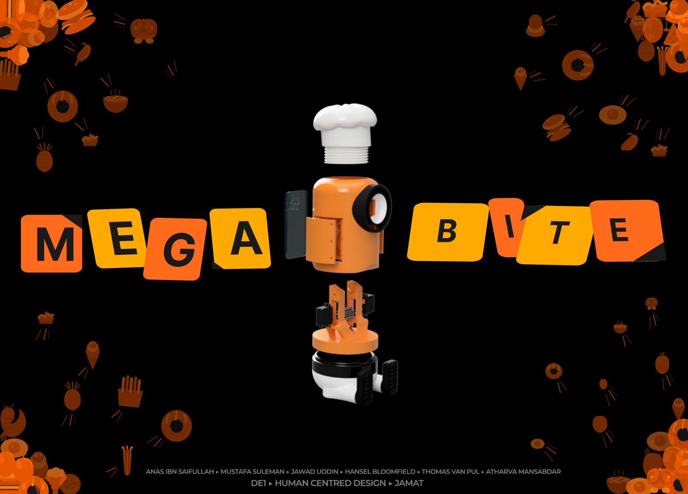
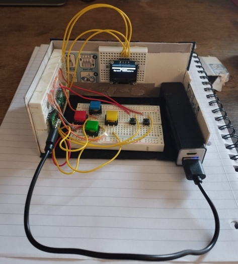
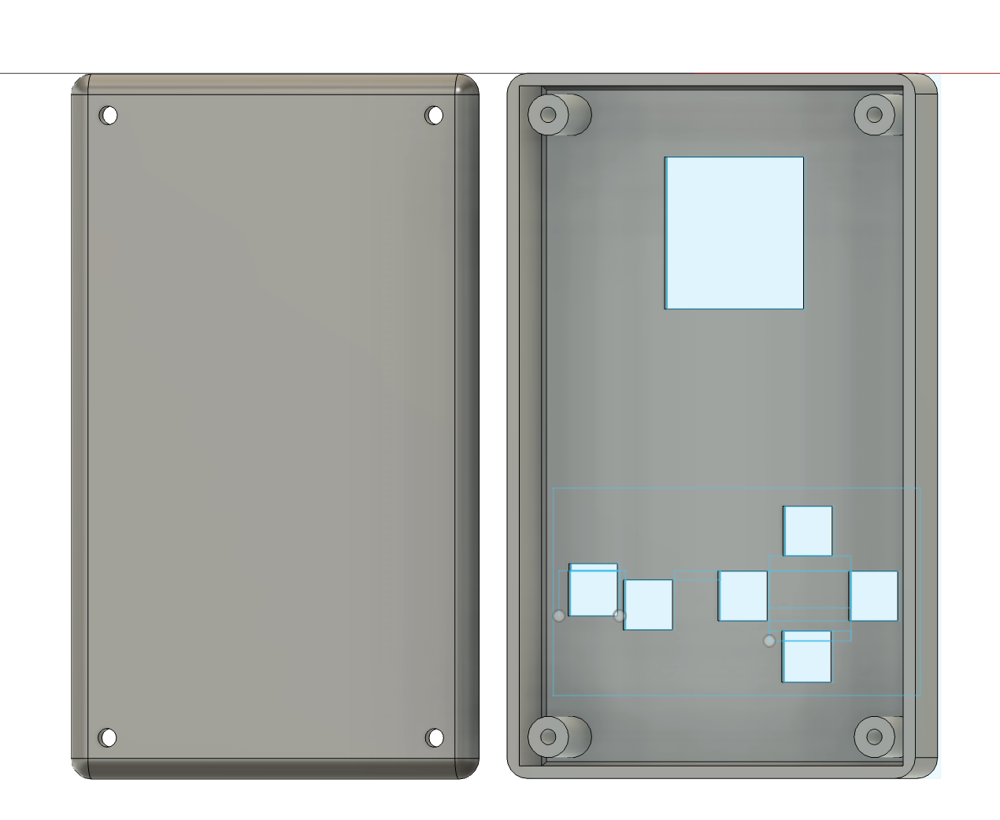
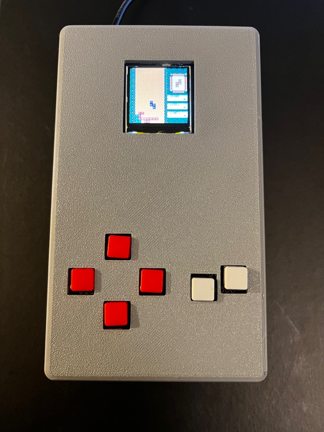

# Mustafa Suleman

**MEng Design Engineering @ Imperial College London · Interested in the intersection of engineering, finance, data and sport · London**

First-class in Year 1 (Dean's List) and part of Imperial's 1st XI. Currently a Data Science Intern at Turnleaf Analytics in London, applying machine learning to macro forecasting; previously a Product Engineering Intern at Tewke, building smart-home hardware. Visiting undergraduate at Stanford, summer 2026.

---

## Featured projects

### [The T20 Analyst](https://github.com/Mustafa-OS/T20-CricketAnalytics)

T20 cricket analytics platform built around **CAIS**, a context-adjusted impact score that re-prices every ball by match phase, pressure, opponent quality and match stage.

### [SVI Vol Surface](https://github.com/Mustafa-OS/BTC-Trading-Project)

Trading platform for Deribit BTC options — SVI volatility-surface fitting with risk, P&L, backtesting and automated delta-hedging.

### [Agora](https://github.com/Mustafa-OS/agora-mvp)

Athlete brand-equity marketplace where fans trade shares in athletes around an engine-suggested fair value — Stanford ENGR145S venture project; I led the algorithm design.

### [Golazo / OVER.](https://github.com/Mustafa-OS/golazo-wc26)

PrizePicks-style player-props game for World Cup 2026 — call More or Less on player stat lines and climb the leaderboard. No betting, points only. **[Play the live demo](https://mustafa-os.github.io/golazo-wc26/)**

### MEGABITE

Gesture-controlled cooking assistant robot — MediaPipe hand tracking, ESP32 firmware, a React control app and a Fusion 360 casing. Imperial DE1 group project (Human Centred Design). *Code in a private team repository — happy to walk through it.*

### Handheld game console

Built from scratch on a Raspberry Pi Pico — Fusion 360 enclosure, soldered PCB and MicroPython games. Breadboard prototype → CAD → finished console:

  
  
  

**Also on this profile:** [MAG-7 ETF stat-arb backtest](https://github.com/Mustafa-OS/MAG-7-ETF-Arbitrage-Strategy) · [ClearVote](https://github.com/Mustafa-OS/ClearVote) (Claude hackathon build) · [heart-disease prediction ML](https://github.com/Mustafa-OS/heart-disease-prediction)

## Skills

Python (pandas, scikit-learn, PyTorch) · JavaScript/React · MATLAB · Fusion 360 · ESP32/embedded

## Contact

[LinkedIn](https://www.linkedin.com/in/mustafaosuleman/) · mustafa.o.suleman@gmail.com
